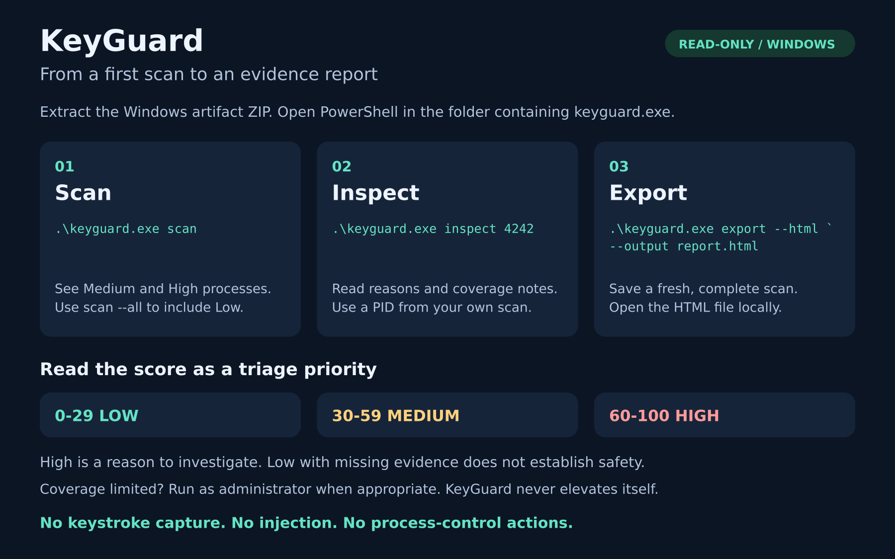
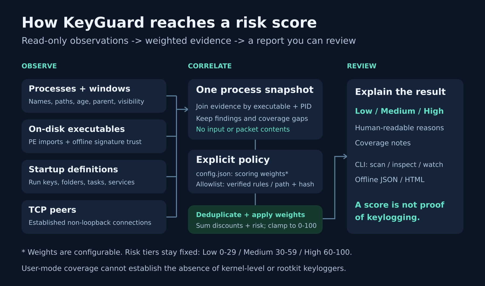
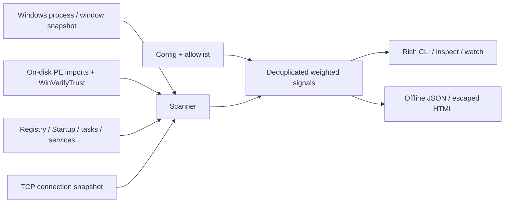
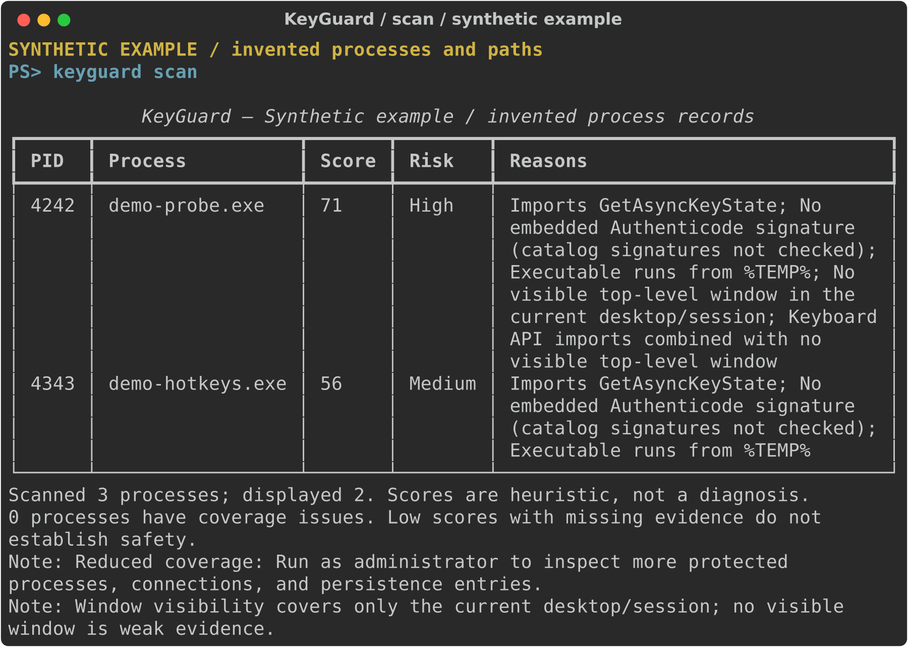
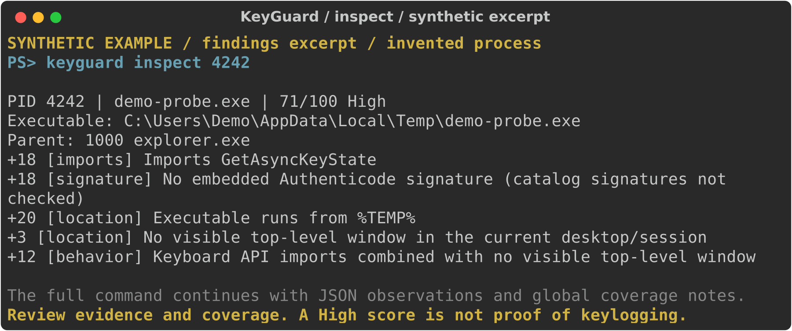

# KeyGuard

KeyGuard is a **read-only Windows 10/11 triage tool** that scores running processes
for combinations of keylogger-like indicators. It explains every score with
concrete observations. It does not prove that a process records keys.

**No keystroke capture, hooks, injection, memory scraping, traffic capture, or
process-control commands.** KeyGuard never suspends, terminates, or deletes a
target. Those actions are intentionally absent, so no process-action confirmation
can be bypassed. Only `allow` changes KeyGuard's own allowlist, and only `export`
writes reports. Scanning makes no intentional target-system changes. Normal
Python/Windows activity can still create bytecode caches, OS audit records, and
file-access metadata; a PyInstaller one-file application extracts itself to a
temporary directory at startup. This is not a forensic zero-write environment.

## Quick start with the Windows executable

Download `KeyGuard-Windows-x64` from a completed successful
[Windows build](https://github.com/violatedheart/Keyguard/actions/workflows/build.yml).
GitHub may require sign-in to download workflow artifacts. Extract the ZIP and
open PowerShell in the folder containing `keyguard.exe` (usually `dist` inside
the extracted artifact).



The commands shown above, ready to copy as single lines:

```powershell
.\keyguard.exe scan
.\keyguard.exe inspect 4242
.\keyguard.exe export --html --output report.html
```

Replace `4242` with a PID from your own scan. See [Install](#install) to run from
Python, and [Usage](#usage) for every command. High scores call for investigation;
a Low score with missing evidence does not establish safety.

## What it checks

| Module | Evidence |
| --- | --- |
| Imports | Normal and delay-loaded PE imports for `SetWindowsHookExA/W`, `GetAsyncKeyState`, `GetKeyState`, `GetKeyboardState`, `RegisterRawInputDevices`, `GetRawInputData` |
| Signature | Offline embedded Authenticode trust through `WinVerifyTrust`; signer read from the verified provider chain |
| Location | Executables in environment-derived Temp, AppData (Roaming and Local), Downloads, and Public directories; current-session visible windows |
| Persistence | HKCU/HKLM Run and RunOnce in 32/64-bit views; user/common Startup folders; recursive hidden/visible scheduled tasks; service executable paths and signatures |
| Network | Established non-loopback TCP peers combined with keyboard imports in an unknown process |
| Behavior | System-name lookalikes, system names outside expected directories, recent process starts, background keyboard imports, and contextual parent anomalies |
| Allowlist | Verified-publisher product rules and editable user rules pinned to executable path + SHA-256 |



<details>
<summary>Text version of the architecture diagram</summary>



</details>

Each collector returns a `Detection` containing findings, observations, and
coverage issues. Its `scored(config["weights"])` view returns the module score,
level, signed contribution, and weighted reasons. These views are also included
in report observations. The scoring engine applies the weights from `config.json`, counts each signal code once,
retains all reasons, sums positive and negative weights, and clamps to 0–100.
Low = 0–29, Medium = 30–59, High = 60–100. Missing evidence adds a coverage issue,
not a fabricated risk signal. A Low score with missing evidence is inconclusive.

For example, keyboard imports (+18), no embedded signature (+18), and execution
from Temp (+20) produce 56/100 Medium before any additional observations. A
background keyboard combination adds +12, producing High. These are triage
weights, not calibrated probabilities or a malware classification model.

### Example output (synthetic data)

These terminal illustrations use the actual CLI rendering functions with invented
processes, paths, and observations. **They are not live Windows scan screenshots**
and do not describe real software or prove any keylogging activity.



`scan` shows Medium/High results by default; `scan --all` includes Low results.
Read the reasons and coverage notes before deciding what to investigate.



`inspect` explains each weighted signal. The full command continues with JSON
observations and global coverage notes. See [the image sources and regeneration
instructions](docs/README.md) for editable SVGs and the synthetic data renderer.

## Install

Use 64-bit Python 3.11+ on Windows 10/11. In PowerShell, from this directory:

```powershell
py -3.11 -m venv .venv
.\.venv\Scripts\python.exe -m pip install --upgrade pip
.\.venv\Scripts\python.exe -m pip install -e ".[dev,build]"
.\.venv\Scripts\keyguard.exe --version
```

For runtime dependencies only, use `pip install .` or
`pip install -r requirements.txt`. The optional GUI is not included; all features
are available in the CLI. `pywin32` is installed only on Windows, so mocked unit
tests and report code can also run on Linux/macOS.

Non-admin scans work with reduced coverage. When useful, open Windows Terminal
using **Run as administrator** and run the same commands. KeyGuard never triggers
UAC or elevates itself. Administrator access still cannot inspect every protected
process or desktop.

## Usage

With the virtual environment's Scripts directory on PATH:

```powershell
keyguard scan
keyguard scan --all
keyguard inspect 1234
keyguard export --json --output report.json
keyguard export --html --output report.html
keyguard allow "C:\Program Files\MyTool\tool.exe"
keyguard watch
```

You can also invoke `python -m keyguard` with the same arguments. Replace `1234`
with a PID from your own scan. `export` runs a fresh full scan and exports every
process plus all collected persistence entries, including entries with no running
match. Existing report files are never overwritten. Without `--output`, exports
receive a timestamped filename in the current directory. Parent output directories
must already exist.

`scan` shows Medium/High processes and suspicious persistence entries. `--all`
shows Low processes too. `inspect` includes observations and per-process coverage
issues; every command also surfaces global coverage notes. Unmatched persistence
entries have path annotations in reports but receive no invented process score.

`watch` starts scans every 30 seconds by default. If a scan takes longer, the next
one starts after it completes. The first snapshot alerts on all High processes;
later snapshots alert on a new process instance or a process returning to High.
Identity uses PID + creation time, preventing ordinary PID reuse from suppressing
alerts. If creation time is inaccessible, PID-only identity is less reliable.
Alerts appear in the terminal and use its bell; terminal sound settings apply.
Ctrl+C stops watch. Config and allowlist changes require restarting watch.

There are no `suspend`, `terminate`, `kill`, or target-deletion commands. Inspect a
finding independently before taking any action through Windows tools.

### Configuration and allowlisting

The installed package/executable uses bundled defaults, independent of the current
directory. Pass global options **before** the subcommand to use editable files:

```powershell
keyguard --config .\config.json --allowlist .\allowlist.json scan --all
keyguard --allowlist .\allowlist.json allow "C:\Tools\Trusted\tool.exe"
```

By default, user rules live in `%LOCALAPPDATA%\KeyGuard\allowlist.json`, falling
back to `%APPDATA%` and then the user's home directory if those variables are
unavailable. A missing file means an empty user list; it is created only by
`allow`. The supplied root `allowlist.json` is an editable empty list, not a list
of unsafe filename-only exemptions.

`allow` is an explicit instruction to add a rule and needs no second prompt.
It accepts an existing `.exe`, hashes it, and atomically updates the chosen JSON:

```json
{
  "schema_version": 1,
  "entries": []
}
```

Entries created by the command contain `path` and lowercase `sha256`. A software
update changes the hash and removes its discount until you verify and allow the
new version. Allowlisted processes remain in reports with all other findings.
User allowlisting lowers risk by the configured weight; it does not guarantee Low.

Built-in rules cover AutoHotkey, NVDA/JAWS screen readers, Steam/NVIDIA overlays,
Microsoft IME/accessibility apps, and common password managers. A rule requires
an exact expected executable basename, a valid embedded signature with an exact
publisher organization, and a Program Files/Windows installation root. Unsigned,
portable, renamed, per-user, or newly signed versions may not match. Use a
path+hash user rule after verifying such software. Never allow a file merely
because its name looks familiar.

All score weights are in `config.json`; positive signal weights and negative
discounts are validated. `trusted_publishers` is an initially empty list of exact
verified signer organizations. Editing it changes trust policy for any executable
with that valid signer. Microsoft discounts also require an exact organization
match after successful trust verification. Valid signatures do not prove safety.

Reports contain local paths, startup command lines, process names, and remote
addresses; review them before sharing. HTML escapes system-controlled strings,
contains no JavaScript or external resources, and embeds complete evidence as
escaped text. JSON is suitable for offline analysis.

## Harmless verification probes

The Python test script makes exactly one modifier-state query and discards its
return value. It never logs/stores key input, creates a hook, or makes a connection:

```powershell
python .\examples\benign_keyboard_probe.py
```

It prints its PID and waits for five minutes; inspect that PID from a second
terminal. **Python's ctypes resolves `GetAsyncKeyState` dynamically, so its PE
import table generally will not contain the API.** This is an intentional
demonstration of static import scanning's limits, not a promised positive result.
PyInstaller packaging of this Python script does not fix that limitation.

For a genuine static import fixture, build the supplied small C equivalent in an
**x64 Native Tools Command Prompt for Visual Studio** (Build Tools with MSVC):

```bat
cd examples
cl /nologo /W4 /Od benign_keyboard_probe.c user32.lib /Fe:benign_keyboard_probe.exe
benign_keyboard_probe.exe
```

From a second terminal, run `keyguard inspect <printed-pid>`. It should report
`Imports GetAsyncKeyState`. No particular risk tier is guaranteed: path, signing,
window visibility, age, and configured weights affect the score. The C program
also queries only Shift once, discards the result, and waits. Both programs stop
naturally after five minutes or with Ctrl+C. Neither creates persistence.

## Tests

```powershell
.\.venv\Scripts\python.exe -m pytest
.\.venv\Scripts\python.exe -m pytest --cov=keyguard --cov-report=term-missing
.\.venv\Scripts\python.exe -m ruff check .
```

Tests cover scoring boundaries and deduplication, normal/delay PE imports,
signature status and FFI state cleanup, path/parent/name/window heuristics,
network correlation, all four persistence sources, constrained allowlists,
mocked end-to-end scans, watch instance tracking, export escaping, CLI dispatch,
and the no-process-control contract. Tests use mocked process/OS data; Windows
smoke tests also call real query-only PE/trust/window/token interfaces. No unit
test registers startup entries, sends traffic, installs hooks, or starts the probes.

## Build the single executable

PyInstaller must run on **Windows** to produce a Windows executable. From this
project's root, in PowerShell:

```powershell
.\.venv\Scripts\python.exe -m PyInstaller --noconfirm --clean --onefile --console --name keyguard --collect-data keyguard --collect-submodules win32com --hidden-import win32timezone --hidden-import win32gui --hidden-import win32process --hidden-import win32security run_keyguard.py
.\dist\keyguard.exe --version
.\dist\keyguard.exe scan --all
```

Result: `dist\keyguard.exe`. Defaults are bundled; editable configuration stays
external through `--config` and `--allowlist`. The build does not request admin
privileges in its manifest. Your executable is unsigned unless you separately
sign it, so SmartScreen or antivirus may request review. Builds are not guaranteed
bit-for-bit reproducible because dependency ranges allow compatible updates.

GitHub Actions tests Python 3.11/3.12/3.13 on `windows-latest`, then builds with
Python 3.11, runs a frozen full scan/export smoke check, and uploads the
`KeyGuard-Windows-x64` artifact. The workflow does not publish a release or upload
scan reports. To use it, push this directory as a repository and open **Actions**.

## Limitations

- This is user-mode heuristic triage. It cannot detect kernel-level/rootkit
  keyloggers, firmware/hardware capture devices, or guarantee discovery of malware.
- PE imports show capability, not actual use. KeyGuard never observes individual
  API calls or active hook registrations. Runtime resolution (`GetProcAddress`,
  ctypes), injected DLLs, scripts, .NET/Python code, packed images, and modules not
  in the executable's own import tables can evade this check. Loaded DLL imports
  and process memory are not scanned. Files over the configured size limit are skipped.
- Signatures are **embedded Authenticode only**, verified offline against the
  machine's trust policy. Windows catalog-only signatures are not queried; such
  files can be reported as having no embedded signature, including Windows files.
  Revocation is not checked. Offline trust errors can include unavailable trust
  material. Multiple/nested signatures are subject to the Windows provider's
  default selection. Local trust stores, valid publisher certificates, and signed
  programs can all be compromised. Signer subject strings alone never earn trust.
- Services are checked through their executable path; Microsoft-signed service
  hosts may load third-party service DLLs that this tool does not inspect. Startup
  parsing does not evaluate arbitrary shell expressions, relative paths, COM task
  actions, or scripts' contents. Registry coverage is the current user plus machine
  Run/RunOnce, not every loaded/unloaded user's hive or every persistence technique.
- Window visibility covers only the current desktop/session. Services, accessibility
  tools, overlays, IMEs, and password managers often have no visible window and use
  keyboard APIs legitimately. These observations need context.
- TCP peers include established inbound sessions as well as possible outbound
  sessions. psutil cannot reliably establish direction from a snapshot. UDP,
  short-lived sockets, packet contents, and exfiltration itself are not observed.
- Snapshots are not atomic. Processes/files can exit, change, or reuse PIDs while
  scanning. Creation-time checks and scan-local file caches reduce common mistakes;
  observed file changes withhold trust discounts, but path/size/mtime checks do not defeat deliberate races or prove the running image
  matches the on-disk file. Parent creation-time checks do not defeat PPID spoofing.
- Access-denied/protected-process failures reduce coverage. A successful scan,
  a Low score, or an allowlist match is not a clean bill of health. False positives
  and false negatives are expected. Investigate with trusted security tooling.

## Responsible use

**For scanning your own machine only.** Keep reports private, verify findings
before acting, and do not treat an indicator as proof of wrongdoing. This project
provides no offensive keylogging functionality. MIT license; see [LICENSE](LICENSE).
